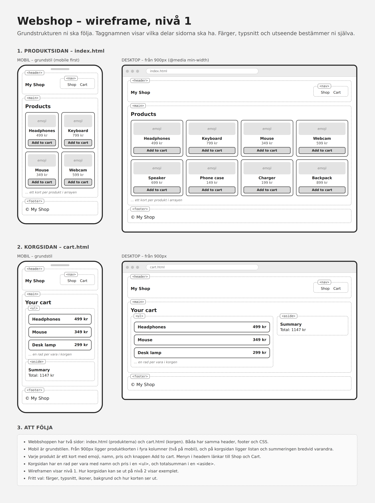
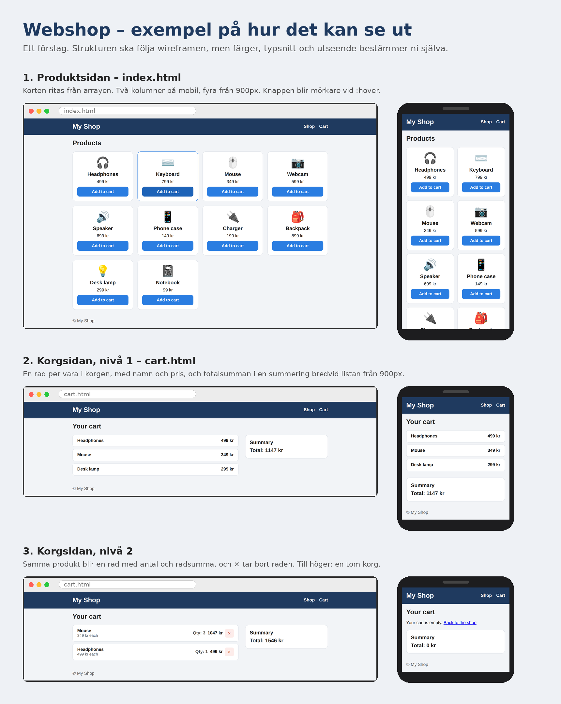

# Webshop

**Miniprojekt 2 · FSTK26M · Onsdag 21/10 och fredag 23/10**

Ni ska bygga en liten webbshop med två sidor. På produktsidan (`index.html`) ser man produkterna och kan lägga dem i en korg. På korgsidan (`cart.html`) ser man vad som ligger i korgen och vad det kostar. Korgen sparas i `localStorage`, så den finns kvar när man byter sida och när man laddar om.

Ni skriver HTML, CSS och JavaScript själva. Det enda ni får färdigt är listan med produkter.

## Wireframe



Wireframen visar strukturen för nivå 1. Färger, typsnitt och utseende bestämmer ni själva.

## Exempel



Ett exempel på hur det kan se ut, inte en mall. Den nedersta delen visar korgsidan på nivå 2.

## Nivåerna

**Nivå 1, det alla ska klara**
- Produkterna visas som kort, ritade från en array.
- *Add to cart* lägger produkten i korgen, och korgen sparas.
- Korgsidan visar varje vara i korgen och totalsumman.
- Båda sidorna har egen HTML och CSS, och fungerar på mobil och dator.

**Nivå 2, när nivå 1 fungerar**
- Samma produkt två gånger blir en rad med antal 2, inte två rader.
- Korgsidan visar antal och radsumma.
- En ×-knapp tar bort en rad.
- En tom korg visar ett meddelande.

**Nivå 3, om ni hinner**
- Plus och minus, en knapp som tömmer korgen, siffran i *Cart (3)*, filter eller sortering. Se slutet av filen.

## Så arbetar ni

- Gruppen har **ett repo** på GitHub. Den som skapar det bjuder in de andra under *Settings, Collaborators*.
- **En person skriver kod åt gången**, och de andra sitter med och tänker högt. Byt person efter varje steg.
- Den som har skrivit gör `git add .`, `git commit` och `git push`. Nästa person kör `git clone` första gången, och sedan `git pull` innan hen börjar.
- Variabler, funktioner, id:n och klasser skrivs på engelska.
- Skriv korta anteckningar om era tekniska val medan ni bygger, till exempel varför ni löste något på ett visst sätt. Dem använder ni i presentationen.
- Fastnar ni: läs *Tänk så här* i steget igen, skriv ut värdena med `console.log`, titta i ert Todo-projekt, och fråga mig.

## Produkterna

Kopiera arrayen och lägg den högst upp i `script.js`. Ändra inte i den.

```js
const products = [
  { id: 1, name: "Headphones", price: 499, emoji: "🎧", category: "audio" },
  { id: 2, name: "Keyboard", price: 799, emoji: "⌨️", category: "computer" },
  { id: 3, name: "Mouse", price: 349, emoji: "🖱️", category: "computer" },
  { id: 4, name: "Webcam", price: 599, emoji: "📷", category: "computer" },
  { id: 5, name: "Speaker", price: 699, emoji: "🔊", category: "audio" },
  { id: 6, name: "Phone case", price: 149, emoji: "📱", category: "phone" },
  { id: 7, name: "Charger", price: 199, emoji: "🔌", category: "phone" },
  { id: 8, name: "Backpack", price: 899, emoji: "🎒", category: "other" },
  { id: 9, name: "Desk lamp", price: 299, emoji: "💡", category: "other" },
  { id: 10, name: "Notebook", price: 99, emoji: "📓", category: "other" },
];
```

## Korgen

- Korgen är en array. Varje rad i den är ett objekt: `{ id, name, price }`.
- Den sparas i `localStorage` under nyckeln `"webshopCart"`. Använd exakt den nyckeln på båda sidorna.
- Alla projekt som körs med Live Server delar `localStorage`. Med en egen nyckel blandas inte korgen ihop med till exempel er Todo-lista.

---

## Del 1: Produktsidan (onsdag)

### Steg 1: Kom igång
Skapa repot och filerna `index.html`, `cart.html`, `style.css`, `script.js` och `cart.js`. Länka `style.css` i båda HTML-filerna. I `<head>` i `index.html` lägger ni `<script src="script.js" defer></script>`, och i `cart.html` lägger ni `<script src="cart.js" defer></script>`.

**Tänk så här:** `defer` gör att skriptet körs först när hela HTML:en är inläst, så att elementen finns när koden letar efter dem.

**Klart när:** filerna ligger på GitHub, och alla i gruppen har klonat repot.

### Steg 2: HTML för produktsidan
Bygg strukturen från wireframen: en header med butikens namn och en meny (`<nav>`) med länkar till `index.html` och `cart.html`, en `main` med en rubrik, och en footer. Produktkorten skriver ni inte i HTML:en. Lägg bara in en tom behållare, till exempel `<div id="productList"></div>`, där korten ska hamna.

**Tänk så här:** allt som kommer från arrayen ritas med JavaScript. HTML:en behöver bara en tom plats som JavaScript kan fylla.

**Klart när:** sidan har alla delar från wireframen i rätt ordning, och länken *Cart* tar er till `cart.html` (som fortfarande kan vara tom).

### Steg 3: Rita produkterna
Kopiera in arrayen högst upp i `script.js`. Skriv en funktion som går igenom arrayen och skapar ett kort för varje produkt, med emoji, namn, pris och en knapp, *Add to cart*. Anropa funktionen längst ner i filen.

**Tänk så här:** det är samma sak som `render()` i Todo: töm behållaren, loopa, skapa element och lägg in dem. Börja med att bara rita ut namnen. När det fungerar lägger ni till emoji, pris och knapp.

**Klart när:** tio kort syns på sidan, och om ni ändrar ett pris i arrayen (och sedan ändrar tillbaka) ändras kortet när ni laddar om.

### Steg 4: Lägg i korgen
Skapa en array för korgen. När man klickar på *Add to cart* ska en rad med produktens `id`, `name` och `price` läggas sist i korgen. Skriv ut korgen med `console.log` efter varje klick.

**Tänk så här:** knappen skapas inuti loopen, så den kan veta vilken produkt den hör till. Det är precis som ×-knappen i Todo, som visste vilken todo den skulle ta bort.

**Klart när:** efter tre klick på olika produkter visar Console en korg med tre rader, och varje rad har rätt namn och pris.

### Steg 5: Spara korgen
Spara korgen i `localStorage` efter varje klick. När sidan startar ska den sparade korgen läsas in, och om det inte finns något sparat (eller om det sparade är trasigt) ska korgen vara tom.

**Tänk så här:** det är samma sak som `save()` och inläsningen i Todo, med en annan nyckel. Läs in korgen innan man kan lägga till något. Annars skriver ni över det som redan var sparat.

**Klart när:** ni lägger i två produkter, laddar om, lägger i en till, och Console visar tre rader. Nyckeln `webshopCart` syns i Application-fliken i DevTools.

### Steg 6: CSS för produktsidan
Styla sidan mobil först. Korten ska ligga i två kolumner på mobil och i fyra från 900px. Knapparna ska reagera när man håller musen över dem (`:hover`).

**Tänk så här:** rutnätet sätter ni på behållaren, inte på korten. Gör det enkelt först, och fixa detaljerna när allt fungerar.

**Klart när:** sidan liknar wireframen i mobilläget i DevTools (390 px) och på en bred skärm, och kolumnerna byter vid 900px.

---

## Del 2: Korgsidan (fredag)

### Steg 7: HTML för korgsidan
Kopiera headern och footern från `index.html`. I `main` lägger ni en rubrik, en tom lista (`<ul>`) för korgens rader och en `<aside>` med en tom plats för totalsumman.

**Tänk så här:** som på produktsidan. Allt som kommer från korgen fylls i med JavaScript, så i HTML:en är de platserna tomma.

**Klart när:** menyn tar er fram och tillbaka mellan sidorna, och de ser likadana ut i headern.

### Steg 8: Läs korgen
I `cart.js` läser ni korgen från `localStorage`, på samma sätt som i steg 5. Skriv ut den med `console.log`.

**Tänk så här:** korgsidan vet ingenting om produktsidan. Det enda de delar är det som ligger sparat under `webshopCart`. Därför behövs samma kod för att läsa in korgen här också.

**Klart när:** ni lägger i två produkter på produktsidan, går till korgsidan via menyn, och Console visar dem. Om ni öppnar korgsidan när ingenting är sparat ska det inte bli något fel.

### Steg 9: Rita korgen
Rita en rad i listan för varje vara i korgen, med namn och pris.

**Tänk så här:** det är `render()` igen, fast med korgen i stället för produkterna. Ni behöver inga knappar på nivå 1.

**Klart när:** raderna på korgsidan stämmer med det ni lade i på produktsidan. Har ni lagt i samma produkt två gånger syns två rader, och det är rätt på nivå 1.

### Steg 10: Totalsumma
Räkna ut vad allt i korgen kostar tillsammans, och visa det, till exempel *Total: 1147 kr*.

**Tänk så här:** börja med en variabel som är 0. Lägg till priset för varje rad i loopen. Efter loopen innehåller variabeln summan.

**Klart när:** summan stämmer när ni räknar själva.

### Steg 11: CSS för korgsidan
Styla korgsidan med samma `style.css`, så att raderna och totalsumman är lätta att läsa på både mobil och dator.

**Klart när:** korgsidan passar ihop med produktsidan, och fungerar i mobilläge och på en bred skärm.

### Steg 12: Testa och pusha
Skriv en kort testtabell i en fil i repot, till exempel `TESTPLAN.md`, med fyra saker ni testar. Varje rad har tre kolumner: vad ni gör, vad ni förväntar er, och vad som faktiskt hände. Pusha sedan allt, och kontrollera att det fungerar för alla i gruppen efter `git pull`.

**Tänk så här:** skriv det förväntade resultatet innan ni testar. Välj saker som kan gå fel, till exempel en tom korg, att ladda om sidan, att gå mellan sidorna eller att lägga i samma produkt två gånger.

**Klart när:** alla fyra rader har ett faktiskt resultat, det som inte stämde är rättat, och `git status` visar att ni är i fas med GitHub. Då är nivå 1 klar.

---

## Nivå 2

Gör stegen i ordning.

### Antal i stället för dubbletter
Lägg till `quantity` i korgens rader. När man klickar på *Add to cart* ska ni först kolla om produkten redan finns i korgen. Finns den ökar ni `quantity` med 1. Finns den inte lägger ni till en ny rad med `quantity: 1`.

**Tänk så här:** ni behöver gå igenom korgen med en loop och jämföra `id` innan ni bestämmer vad som ska hända. Töm den sparade korgen i Application-fliken när ni ändrar formen på raderna, annars blandas gamla rader utan `quantity` in.

**Klart när:** tre klick på samma produkt ger en rad med `quantity` 3.

### Antal och radsumma
Visa antalet på varje rad på korgsidan, och radsumman (pris gånger antal). Totalsumman ska också räkna med antalet.

**Tänk så här:** en rad kan nu vara värd mer än sitt pris. Vad behöver ändras i loopen som räknar ut totalsumman?

**Klart när:** tre av en produkt för 349 kr visar 1047 kr, och totalsumman stämmer.

### Ta bort en rad
Lägg en ×-knapp på varje rad som tar bort raden, sparar korgen och ritar om listan.

**Tänk så här:** det är samma sak som att ta bort en todo.

**Klart när:** ni tar bort mittenraden av tre, och rätt rad försvinner, också efter omladdning.

### Tom korg
Visa ett meddelande och en länk till produktsidan när korgen är tom.

**Klart när:** meddelandet syns när korgen är tom, och försvinner när det finns något i den.

## Nivå 3

Välj själva.

- **Plus och minus** på varje rad. Når antalet 0 tas raden bort.
- **Töm korgen** med en knapp.
- **Siffran i menyn,** *Cart (3)*, på båda sidorna.
- **Filtrera** produkterna efter `category`.
- **Sortera** produkterna på pris.

## Presentation

Sist på fredagen visar varje grupp sin webbshop, ungefär fem minuter per grupp.

- Visa hur den ser ut och fungerar, på mobil och på dator.
- Visa två rader ur er testtabell, och gör testerna live, till exempel en tom korg eller att ladda om sidan.
- Berätta vad som var klurigast, och något ni valde själva. Alla i gruppen säger något.
